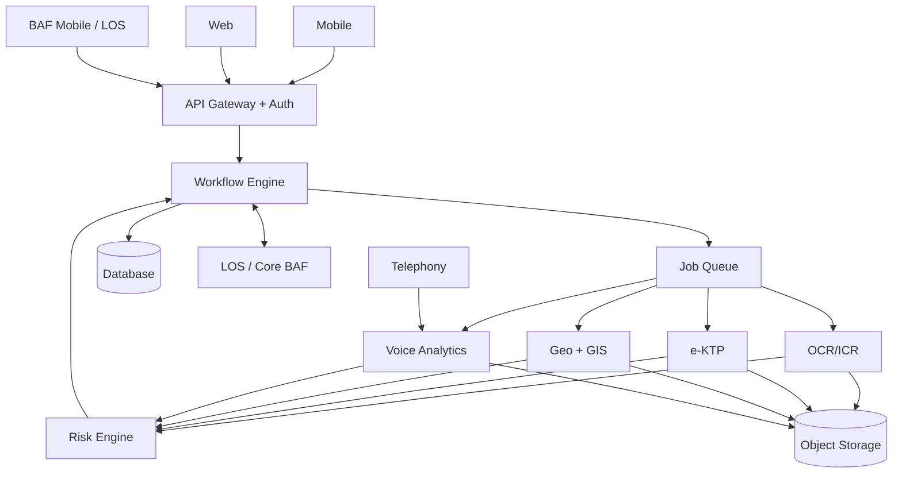
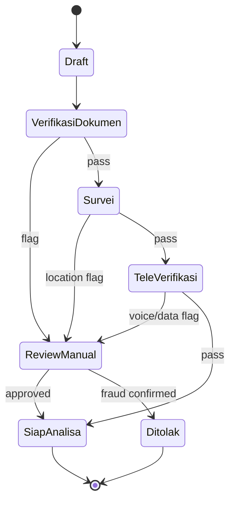
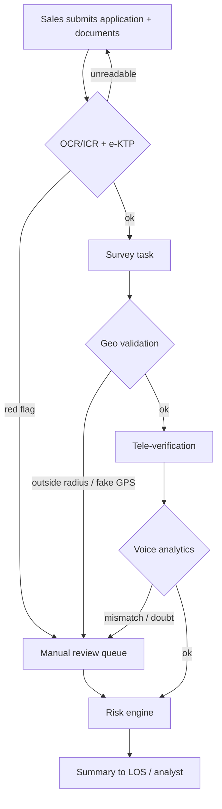

# VeriFin for BAF: Backend & Processing PRD

**Working name:** VeriFin (placeholder) · **Version:** Draft v0.1 · **Date:** 29 Oct 2026 · **Status:** For review

Items marked **[Assumption]** need confirmation from the partner or BAF. Credit analyst scoring is out of scope (deferred by BAF).

Sources: *Perancangan Aplikasi BAF v0.1*, *Fitur, Use Case & Rencana Demo v0.2*, *Kebutuhan BAF*.

---

## 1. Overview

### 1.1 Purpose
This PRD defines the requirements for the **backend platform** (API, workflow, data, risk engine, integrations) and the **processing pipelines** (OCR/ICR, e-KTP validation, geo validation and GIS, voice analytics) that power VeriFin. The mobile app (Sales, Surveyor) and web dashboard (Verifikator, QA, Supervisor, Admin) are specified separately and consume the APIs defined here.

### 1.2 Problem
BAF receives high volumes of financing applications from many branches. Document checks, field surveys and verification calls are largely manual, which makes them slow and exposed to fraud (edited KTPs, surveys done from home, coached customers) and to agent errors.

### 1.3 Product goal
For every application, automatically check three things and produce a **risk score (0-100) and flags with reasons**:

| Check | Question | Pipeline |
|---|---|---|
| Data | Are documents and KTP genuine and consistent? | OCR/ICR, e-KTP |
| Location | Did the surveyor really visit the customer's address? | Geo validation, GIS |
| Communication | Did the verification call follow standard, match the data, and was the customer confident? | Voice analytics |

### 1.4 Scope

| Phase | Backend and processing scope |
|---|---|
| **Demo / PoC** | UC-01, 02, 04, 05, 06, 07, 09 on dummy data; mocked or simplified integrations |
| **Phase 1 (MVP)** | OCR, e-KTP, geo tagging, basic GIS, tele-verification voice analytics, risk engine, pilot in 1-2 branches |
| **Phase 2** | ICR for survey forms, collection and CS QA, risk heatmap, full LOS integration |
| **Phase 3** | Credit analyst scoring, property collateral plotting, external data integrations |

**Out of scope (Phase 1):** credit scoring, BPN integration, native iOS.

### 1.5 Users of the backend
Mobile app, web dashboard, BAF Mobile (applicant self-submission via API), LOS/core BAF, telephony/recording system, and Dukcapil **[Assumption: only if BAF has official access]**.

---

## 2. Goals and Success Metrics

No accuracy figures are promised until tested on BAF data in the pilot. Targets below are starting points.

| Area | Metric | Target |
|---|---|---|
| Speed | OCR latency per document | < 5 s (from source NFR) |
| Speed | Voice analysis time | < 1x call duration (to be tuned) |
| Speed | Geo validation result returned to mobile | < 3 s online **[Assumption]** |
| Quality | OCR field accuracy, ICR accuracy, STT word error rate, fraud detection recall/precision | **TBD from pilot** on BAF data |
| Coverage | Share of verification calls analyzed | 100% (vs. sampling today) |
| Efficiency | Reduction in manual re-entry and QA listening time | Baseline during pilot |
| Reliability | Platform availability | 99.5% **[Assumption]** |

---

# Part A: Backend Platform

## 3. Architecture

Components (from the design document):

- **API Gateway and Auth**: single entry for mobile, web and external API clients.
- **Workflow Engine**: owns application status and orchestrates processing jobs.
- **Rule and Risk Engine**: combines module outputs into score and flags.
- **Processing modules**: OCR/ICR, e-KTP, Geo, GIS, Voice Analytics (Part B).
- **Data stores**: relational database for application data, object storage for documents, photos and audio, spatial store for map data.
- **Integrations**: LOS/core BAF, Dukcapil, telephony/recording, basemap and geocoding.

**Design principles**
1. Processing is **asynchronous** (queue-based) except lightweight checks that mobile needs immediately (photo quality, geo status).
2. Every module returns a **standard result envelope**: `status`, `confidence`, `findings[]`, `evidence_refs[]`, `model_version`, `processed_at`.
3. Every AI result is a **signal for human review, not proof of fraud**. Final decisions are made by people.
4. All thresholds and weights are configuration, not code.

---

## 4. Functional Requirements: Platform

Priority: **P0** = needed for Demo/MVP, **P1** = Phase 2, **P2** = later.

### 4.1 Authentication, authorization, users

| ID | Requirement | Priority |
|---|---|---|
| BE-AUTH-01 | Token-based authentication for mobile and web; short-lived access tokens with refresh | P0 |
| BE-AUTH-02 | Role-based access control for roles: Sales, Surveyor, Verifikator, QA Officer, Supervisor, Credit Analyst, Admin, System | P0 |
| BE-AUTH-03 | Branch-scoped data access (a Supervisor sees only their branch/region unless granted) | P0 |
| BE-AUTH-04 | Service-to-service credentials for LOS, BAF Mobile and telephony integrations | P0 |
| BE-AUTH-05 | Device binding for mobile accounts and session revocation by Admin | P1 |
| BE-AUTH-06 | SSO with BAF identity provider **[Assumption]** | P2 |

### 4.2 Application and workflow management

| ID | Requirement | Priority |
|---|---|---|
| BE-WF-01 | Create, read, update applications (Pengajuan) with product, branch, sales, consumer data | P0 |
| BE-WF-02 | Status state machine: Draft, Verifikasi Dokumen, Survei, Tele-Verifikasi, Review Manual, Siap Analisa, Ditolak | P0 |
| BE-WF-03 | Automatic transitions: pass moves to next stage; any red flag or low-confidence result moves to Review Manual | P0 |
| BE-WF-04 | Manual decision endpoint (Verifikator): continue, request re-submission, reject (fraud); requires a note | P0 |
| BE-WF-05 | Task assignment: survey tasks to Surveyors, review items to Verifikators, with a task list per user | P0 |
| BE-WF-06 | Push notifications and webhooks on status change and new flags | P1 |
| BE-WF-07 | Idempotent submissions and safe retries (no duplicate applications on weak connections) | P0 |
| BE-WF-08 | SLA timers per stage with escalation to Supervisor | P2 |

Status flow:

### 4.3 Risk and rule engine

| ID | Requirement | Priority |
|---|---|---|
| BE-RISK-01 | Combine module outputs (document, e-KTP, location, voice) into a composite **score 0-100** | P0 |
| BE-RISK-02 | Assign overall flag **green / yellow / red**, with each flag carrying module, severity, reason text and evidence reference | P0 |
| BE-RISK-03 | Configurable weights, thresholds and hard rules (e.g. e-KTP manipulation = automatic red regardless of score) | P0 |
| BE-RISK-04 | Recompute score when any module result changes or a reviewer overrides a flag | P0 |
| BE-RISK-05 | Explainability: the API returns the contribution of each module and rule to the score | P0 |
| BE-RISK-06 | Rule versioning: each score records the rule-set version used | P1 |
| BE-RISK-07 | Simulation: test new thresholds against historical applications before activation | P2 |

**Initial scoring approach [Assumption]:** weighted rule-based aggregation. Direction: higher score = higher risk. Default weights are set during the pilot using BAF data; ML-based scoring is not in Phase 1.

### 4.4 Flag and review queue

| ID | Requirement | Priority |
|---|---|---|
| BE-FLAG-01 | Persist flags with module, level, reason, evidence, status (open, in review, resolved, dismissed) | P0 |
| BE-FLAG-02 | Unified review queue endpoint across documents, location and voice, filterable by branch, module, level, assignee, date | P0 |
| BE-FLAG-03 | Reviewer actions: confirm, dismiss with reason, escalate | P0 |
| BE-FLAG-04 | Reviewer corrections feed a labeled dataset for model improvement (opt-in per BAF policy) | P1 |

### 4.5 Configuration (Admin)

| ID | Requirement | Priority |
|---|---|---|
| BE-CFG-01 | Manage geo radius thresholds (default: >200 m yellow, >1 km red) | P0 |
| BE-CFG-02 | Manage risk weights and thresholds, OCR confidence threshold | P0 |
| BE-CFG-03 | Manage verification call scripts: mandatory items, prohibited words/tones | P0 |
| BE-CFG-04 | Manage branch geofences and survey work areas | P1 |
| BE-CFG-05 | Every change records who, when, before and after, with an effective-from date | P0 |

### 4.6 Reporting

| ID | Requirement | Priority |
|---|---|---|
| BE-RPT-01 | Aggregates: applications, flags, average score per branch, surveyor, agent, period | P1 |
| BE-RPT-02 | Surveyor and agent performance metrics (counts, flag rate, QA score) | P1 |
| BE-RPT-03 | Export to Excel and PDF, generated asynchronously | P1 |
| BE-RPT-04 | Dashboard home summary: today's applications, open flags, average score | P0 |

### 4.7 Audit trail

| ID | Requirement | Priority |
|---|---|---|
| BE-AUD-01 | Immutable log for decisions, flag changes, config changes, data access to sensitive artifacts (KTP image, audio) | P0 |
| BE-AUD-02 | Log fields: user, action, object, timestamp, before/after, source IP/device | P0 |
| BE-AUD-03 | Audit queries by Admin/Compliance, retention per BAF policy **[Assumption: to be confirmed]** | P1 |

---

## 5. Data Model

| Entity | Key fields |
|---|---|
| Application (Pengajuan) | id, product, branch, sales_id, status, risk_score, risk_flag, rule_version |
| Consumer | nik (encrypted), name, birth_date, ktp_address, domicile_address, address_coordinate |
| Document | type, file_ref, extraction (JSON), confidence, validation_status, model_version |
| Survey | surveyor_id, time, coordinate, accuracy, distance_to_address, photos[], form_result, device_info, mock_location_flag |
| Recording | source, duration, transcript, speaker_segments, intonation_scores, spelling_result, script_result, qa_score |
| Flag | application_id, module, level, reason, evidence_ref, review_status, reviewer |
| Rule | parameter, value, effective_from, changed_by |
| Audit log | user, action, object, time, before, after |

Storage notes:
- Documents, photos and audio go to **object storage**; the database holds references and metadata.
- Photos keep original EXIF/metadata unchanged alongside server-side capture data.
- Spatial data (coordinates, geofences, routes) uses a spatial-capable database extension **[Assumption]**.
- NIK is encrypted at rest and masked in all API responses unless the role explicitly permits full view.

---

## 6. API Requirements

### 6.1 General
- REST over HTTPS with JSON, versioned (`/v1`), documented with OpenAPI.
- Pagination, filtering and sorting on all list endpoints.
- Idempotency keys on create and upload endpoints.
- Large files (images, audio) uploaded through pre-signed upload URLs; the API then receives a file reference.
- Consistent error format with codes and correlation ID.
- Rate limiting per client.

### 6.2 Endpoint groups (indicative)

| Group | Examples |
|---|---|
| Auth | login, refresh, logout, me |
| Applications | create, get, list, update, submit, decide |
| Documents | request upload URL, register document, get extraction, submit correction |
| e-KTP | get validation result, submit selfie for face match |
| Survey | list tasks, start, upload geo-tagged photo, submit form, get geo status, submit out-of-radius reason |
| GIS | query points by branch/date/status, surveyor route per day, heatmap tiles (P1) |
| Voice | register recording, get transcript, analysis, QA score, add coaching note |
| Risk and flags | get score with breakdown, list flags, review action |
| Config | get/update thresholds, weights, scripts, geofences |
| Reports | request export, download |
| Integration | LOS pull/push, BAF Mobile submission, telephony recording webhook |
| Audit | query logs |

### 6.3 Real-time and callbacks
- Webhook/push to mobile for geo status and review outcome.
- Webhook subscriptions for LOS to receive verification result and score.

---

## 7. Integrations

| System | Direction | Requirement | Dependency |
|---|---|---|---|
| LOS / core BAF | Two-way | Pull application data; push verification result, score and flags | LOS type and API readiness unknown |
| BAF Mobile | Inbound | Applicant self-submission via API | API contract to be agreed |
| Telephony / recording | Inbound | Automatic recording ingest (batch or real-time); upload fallback | System and audio format unknown |
| Dukcapil | Outbound | NIK and face verification | **[Assumption]** only with official agreement; demo uses simulated data |
| Basemap and geocoding | Outbound | Map tiles and address-to-coordinate | Provider choice open; Indonesian address coverage must be evaluated |
| BPN / land data | Outbound | Not planned; no public API visible | Phase 3, needs official cooperation |

Integration rules: adapter layer per external system so the core is unaffected by LOS or telephony differences; all calls logged; graceful degradation (e.g. Dukcapil unavailable results in the check marked "not performed", not "passed").

---

## 8. Non-Functional Requirements: Platform

| Category | Requirement |
|---|---|
| Security | Encryption in transit and at rest; role-based access; NIK masking; secrets management; secure audio and image access via short-lived URLs |
| Compliance | UU PDP and OJK requirements; data residency in Indonesia; consent and retention rules to be confirmed with BAF |
| Deployment | Indonesian cloud region or on-premise, selected after BAF confirms preference **[Open]** |
| Scalability | Horizontal scaling of workers per pipeline; sizing after BAF provides monthly document and recording volume |
| Availability | Target 99.5%, graceful degradation when a processing module is down (application waits in queue, never silently passes) |
| Observability | Centralized logs, metrics and tracing; per-module latency and failure dashboards; alerting |
| Backup and DR | Defined RPO/RTO for database and object storage **[Assumption: to be set with BAF]** |
| Data retention | Configurable per data type (documents, audio, photos) |
| Environments | Dev, staging, production; demo environment seeded with dummy data |
| Maintainability | Versioned models and rules; rollback of a model or rule set without redeploying the platform |

---

# Part B: Processing Pipelines

All pipelines run as asynchronous workers behind the job queue, except where marked as synchronous. Each one writes a standard result envelope (see section 3) and may raise flags to the Risk Engine.

## 9. Document Processing: OCR and ICR

### 9.1 Purpose
Read documents into structured data, auto-fill the application form, and check consistency across documents.

### 9.2 Requirements

| ID | Requirement | Priority |
|---|---|---|
| PR-OCR-01 | Classify document type (KTP, KK, NPWP, payslip, STNK, BPKB, invoice) | P0 |
| PR-OCR-02 | Extract fields from printed documents into JSON with per-field confidence | P0 |
| PR-OCR-03 | Image quality assessment (blur, glare, cropping, rotation); reject with reason when unreadable. A lightweight check also runs on-device in the mobile app | P0 |
| PR-OCR-04 | Image preprocessing: deskew, perspective correction, denoise | P0 |
| PR-OCR-05 | Fields below the confidence threshold are marked **yellow** for manual check | P0 |
| PR-OCR-06 | Cross-check KTP vs KK vs payslip for name, NIK, address consistency; mismatches become flags | P0 (simple), P1 (fuzzy matching) |
| PR-OCR-07 | Manual corrections stored with original value, corrected value and user, for training data | P1 |
| PR-ICR-01 | Read handwriting on survey forms using semi-structured templates | P1 |
| PR-ICR-02 | Return per-field confidence for handwriting; low-confidence fields go to the surveyor for correction | P1 |
| PR-ICR-03 | Collateral certificate reading (SHM/SHGB) | P2 **[Assumption: only if BAF has property collateral]** |

### 9.3 Inputs and outputs
- **Input:** image or PDF reference, document type hint (optional), application ID.
- **Output:** document type, extracted fields with confidence, quality score, consistency findings, status (ok / low confidence / unreadable).

### 9.4 Performance and quality
- Latency under 5 s per document (target).
- Accuracy measured per field on BAF samples during the pilot; no figure is promised before then.
- Handles typical field conditions: phone-camera photos, uneven lighting, worn or laminated cards.

---

## 10. e-KTP Validation

### 10.1 Purpose
Catch fraudulent or inconsistent identity documents at submission, before survey and call costs are incurred.

### 10.2 Requirements

| ID | Requirement | Priority |
|---|---|---|
| PR-KTP-01 | NIK structure check: region code, birth date, gender code, against extracted fields | P0 |
| PR-KTP-02 | Manipulation detection: digital editing, photo of a screen, photocopy, pasted overlays. Outputs a manipulation score and the suspicious region(s) | P0 |
| PR-KTP-03 | Internal duplicate check: same NIK or same KTP photo used in other applications | P1 |
| PR-KTP-04 | Face match between selfie and KTP photo | P1 (optional) |
| PR-KTP-05 | Liveness detection to confirm selfie is a live person | P1 (optional) |
| PR-KTP-06 | Dukcapil verification of NIK/data/face | P2 **[Assumption: official access required]** |
| PR-KTP-07 | Result is one of **valid / needs review / invalid** with reasons; manipulation indication forces **needs review** at minimum | P0 |

### 10.3 Notes
- Output is an indicator for review, not a legal determination of forgery.
- Without Dukcapil access, the system can detect image-level manipulation and internal inconsistencies, but not confirm that a NIK exists in the population database. The result must state this limitation.
- Test data must be fictitious; never use real people's KTPs in demo.

---

## 11. Geo Validation and GIS

### 11.1 Purpose
Prove the surveyor was physically at the consumer's address and give supervisors a spatial view of surveys and risk.

### 11.2 Geo validation requirements

| ID | Requirement | Priority |
|---|---|---|
| PR-GEO-01 | Accept only photos captured through the app camera; reject or flag photos without capture metadata (gallery imports) | P0 |
| PR-GEO-02 | Record GPS coordinate, accuracy and device timestamp; add **server-received timestamp** and compare | P0 |
| PR-GEO-03 | Detect mock location / fake GPS signals reported by the app; flag on server using the reported device indicators and inconsistency checks (e.g. implausible speed between points, repeated identical coordinates, poor accuracy) | P0 |
| PR-GEO-04 | Geocode the consumer address to coordinates, store geocode confidence | P0 |
| PR-GEO-05 | Compute distance between photo coordinate and address coordinate; apply configurable radius rules (default: >200 m yellow, >1 km red) | P0 |
| PR-GEO-06 | If geocode confidence is low, do not auto-red; mark "address uncertain" and allow reviewer to set the reference point | P0 |
| PR-GEO-07 | Require a reason when outside the radius; store with the flag | P1 |
| PR-GEO-08 | Duplicate photo detection: the same or near-identical photo used across different consumers (perceptual hashing) | P1 |
| PR-GEO-09 | Offline sync: accept batches captured offline; validate using device time and coordinates plus server checks on arrival, and flag suspicious delays | P1 |
| PR-GEO-10 | Visit checks: required photo set present (house front, business, environment) | P1 |

### 11.3 GIS requirements

| ID | Requirement | Priority |
|---|---|---|
| PR-GIS-01 | Provide point data of applications and surveys with status color (green / yellow / red), filter by branch, date, status | P0 |
| PR-GIS-02 | Surveyor daily route and visit points ordered by time | P0 |
| PR-GIS-03 | Point detail linking back to the application | P0 |
| PR-GIS-04 | Risk heatmap by area, based on flag density | P1 |
| PR-GIS-05 | Branch geofence and work-area checks (survey outside assigned area) | P1 |
| PR-GIS-06 | Nearest-task search for surveyors | P1 |
| PR-GIS-07 | Collateral property plotting | P2 **[Assumption]** |

### 11.4 Notes
- Indonesian addresses are often informal; geocoding quality is a known risk. Mitigate with address normalization, confidence scores and the reviewer override in PR-GEO-06.
- Location tracking of surveyors is personal data about employees; the tracking scope (visit points vs continuous) must be agreed with BAF HR/legal.

---

## 12. Voice Analytics

### 12.1 Purpose
Analyze 100% of verification calls to confirm data accuracy, detect doubt or coaching of the customer, and score agent compliance. Voice is **backend and web only**; there is no voice feature on mobile.

### 12.2 Requirements

| ID | Requirement | Priority |
|---|---|---|
| PR-VOI-01 | Ingest recordings from telephony (batch or real-time) or manual upload; link each recording to an application | P0 (upload), P1 (telephony) |
| PR-VOI-02 | Speech-to-text for Bahasa Indonesia with timestamps | P0 |
| PR-VOI-03 | Speaker separation: agent vs consumer (stereo channel split where available, diarization otherwise) | P0 |
| PR-VOI-04 | Spelling and data verification: compare spoken name, NIK, address, date of birth, unit, installment amount with system data; output match / mismatch per item with timestamp | P0 |
| PR-VOI-05 | Agent intonation analysis: friendly, curt, rushed | P0 |
| PR-VOI-06 | Consumer doubt detection: long pauses, hesitant tone when asked for data | P0 |
| PR-VOI-07 | Script compliance: greeting, identification, mandatory statements, closing, checked against the configured script | P0 |
| PR-VOI-08 | QA score per call plus problem segments with start/end timestamps | P0 (basic), P1 (full) |
| PR-VOI-09 | Coaching notes storage per call and agent | P1 |
| PR-VOI-10 | Collection QA: rude or threatening tone, compliance with collection ethics, consumer emotion | P1 |
| PR-VOI-11 | Customer service and telesales analysis (sentiment, interest) | P2 |
| PR-VOI-12 | Mapping to risk engine: data mismatch and doubt signals raise a flag with timestamped evidence | P0 |

### 12.3 Inputs and outputs
- **Input:** audio file, application reference, script template, speaker channel info.
- **Output:** transcript with speaker labels, spelling verification table, intonation scores per speaker, doubt events, script checklist result, QA score, highlighted segments.

### 12.4 Notes and constraints
- Intonation and doubt detection are **indicators, not proof of fraud**. UI and API wording must reflect this, and flags route to a human.
- Regional accents and languages: Phase 1 supports Bahasa Indonesia; accent performance is evaluated in the pilot **[Open]**.
- Spoken digits (NIK, amounts) and names are error-prone in STT; comparison logic must allow normalization (e.g. "dua juta lima ratus" to 2,500,000) and phonetic tolerance for names, with confidence reported.
- Recording consent and retention follow BAF policy and regulation; confirm that call-recording notice already exists in BAF's process.
- Target: processing under 1x call duration.

---

## 13. Processing Orchestration

| ID | Requirement | Priority |
|---|---|---|
| PR-ORC-01 | Each pipeline is an independent worker pool consuming from a job queue | P0 |
| PR-ORC-02 | Retry with backoff on transient failure; dead-letter queue and alert on repeated failure | P0 |
| PR-ORC-03 | Job status visible per application (queued, processing, done, failed) | P0 |
| PR-ORC-04 | A failed or timed-out module marks its check "not completed"; the application cannot silently pass without it | P0 |
| PR-ORC-05 | Model and ruleset versions recorded with every result; re-processing supported when a model is upgraded | P1 |
| PR-ORC-06 | Priority lanes: interactive jobs (mobile waiting for quality or geo status) ahead of batch jobs (audio, reports) | P0 |
| PR-ORC-07 | Cost and usage metering per pipeline (pages, minutes of audio) for sizing and billing | P1 |

End-to-end flow:

---

## 14. Demo Requirements (Backend and Processing)

Per the demo plan (10-15 minutes, clickable prototype with dummy data, backup screen recording):

| Demo scene | Backend/processing needed |
|---|---|
| 1. Sales scans KTP and payslip | OCR with auto-fill result and one low-confidence field |
| 2. Edited KTP | e-KTP manipulation result: red, in review queue |
| 3. Survey on location | Geo status green with distance |
| 4. Survey out of radius (1.2 km) or mock location | Geo status red with reason |
| 5. Supervisor map | 20-30 dummy points green/yellow/red, one surveyor route |
| 6. Tele-verification | Transcript, two timestamped highlights: wrong birth date and hesitant tone |
| 7. QA | Agent intonation score, missed script items, coaching note |
| 8. Risk summary | Composite score with module breakdown and reasons |

For the demo, it is acceptable for these to be **pre-computed results served by the real API contracts** (or simulated services), as long as the demo does not claim live integration with Dukcapil, BPN, LOS or telephony. The dummy data set is defined in the demo plan: 2 KTPs (1 edited), 1-2 payslips, 3 geo-tagged photos, 20-30 map points, 2 call recordings, 1 handwritten form (optional), 1 script template.

---

## 15. Risks and Open Questions

### 15.1 Risks

| Risk | Impact | Mitigation |
|---|---|---|
| Sensitive personal data (KTP, voice, location) | Legal and reputational | Encryption, RBAC, masking, audit, Indonesian data residency, on-premise option |
| Indonesian address geocoding is inaccurate | False flags | Confidence score, "address uncertain" state, reviewer override |
| Voice indicators misread as proof of fraud | Wrongful rejection | Position as flags for human review; no auto-reject |
| Accents and regional languages reduce STT accuracy | Missed or false findings | Pilot evaluation; report confidence |
| No Dukcapil/BPN access | Cannot confirm NIK authenticity | Image-level checks only; state limitation clearly; do not promise in demo |
| No case study yet | Credibility | Offer pilot in 1-2 branches |
| Unknown LOS and telephony systems | Integration effort | Adapter layer; confirm early |

### 15.2 Open questions (blocking for backend design)

1. Which LOS does BAF use, and is its API ready?
2. Which telephony/recording system and audio format?
3. Does BAF have official Dukcapil access?
4. Cloud (Indonesian region) or on-premise?
5. Monthly volume of documents and recordings (for sizing)?
6. Priority for voice analytics: tele-verification, collection or CS first?
7. Does BAF offer property-collateral products (affects ICR on certificates and GIS plotting)?
8. Retention periods and consent rules for audio and location data?
9. Scope of surveyor location tracking (visit points only vs continuous)?
10. Expected format for the presentation (deck only vs live demo)?

---

## 16. Release Plan

| Milestone | Backend and processing deliverable |
|---|---|
| **Demo / PoC** | Core API contracts, seeded dummy data, OCR + e-KTP + geo + voice results for demo scenario, risk summary endpoint |
| **Phase 1 (MVP, pilot 1-2 branches)** | Auth/RBAC, workflow engine, OCR, e-KTP image checks, geo validation, basic GIS, voice analytics for tele-verification, risk engine, audit trail, admin config, monitoring |
| **Phase 2** | ICR forms, collection and CS QA, heatmap, geofences, full LOS integration, reporting and exports, duplicate detection |
| **Phase 3** | Credit analyst scoring, collateral plotting, Dukcapil and external data integrations |

---

## 17. Acceptance Criteria (Phase 1)

1. An application moves through all statuses automatically, with every red flag stopping in Review Manual.
2. Each pipeline returns the standard result envelope, including confidence and model version.
3. A failed pipeline never produces a "pass".
4. A risk score always shows per-module contributions and flag reasons.
5. Every decision, flag change and config change appears in the audit log.
6. NIK is masked in all responses except for explicitly permitted roles.
7. Threshold changes (radius, weights, OCR confidence, script) take effect without redeployment.
8. OCR latency under 5 s per document under agreed load; voice analysis under 1x call duration (pilot-tuned).
9. Accuracy results for OCR, e-KTP checks, STT and spelling verification are measured on BAF pilot data and reported before any production rollout decision.

---

## 18. Technology Stack (Proposed)

**Status:** Proposal only. No stack has been decided in the source documents. Final choices depend on BAF's answers on deployment (cloud vs on-premise), LOS, and telephony (see 15.2), and on pilot testing of the AI components.

### 18.1 Proposed stack

| Layer | Proposed | Alternatives / notes |
|---|---|---|
| Core API and workflow | Python (FastAPI), or NestJS/Go if the team prefers | One language across API and AI workers keeps the team small |
| Job queue and workers | Celery + Redis, or RabbitMQ | Kafka only if volume or real-time call ingest justifies it |
| Database | PostgreSQL + PostGIS | PostGIS covers radius checks, geofences, routes and heatmaps |
| Object storage | S3-compatible storage | MinIO if on-premise |
| Auth | Keycloak, or built-in JWT + RBAC | Keycloak helps if BAF wants SSO later |
| OCR/ICR | PaddleOCR or a managed document AI service, plus custom field extraction | Test on real Indonesian KTP, KK and payslip photos before choosing; handwriting (ICR) may need a fine-tuned model |
| e-KTP validation | NIK rule checks plus a custom computer-vision model (PyTorch) for tampering and screen-photo detection | Face match and liveness can come from a vendor SDK instead of being built |
| Speech-to-text | Whisper fine-tuned for Bahasa Indonesia, or a cloud STT service | Needs a pilot test on accents; managed services are easier but data leaves BAF's environment |
| Voice analysis | Speaker diarization (e.g. pyannote), speech-emotion models, pause/hesitation features, and an LLM or rules for script compliance and spelling matching | Intonation and doubt detection are the least mature parts; budget research time |
| Geocoding and maps | Google Maps or Mapbox for geocoding, MapLibre on the web dashboard | OpenStreetMap is cheaper but Indonesian address coverage is weaker; evaluate on real addresses |
| Mobile (Android) | Kotlin native | Native gives better control over camera, mock-location detection and Play Integrity checks needed for geo tagging |
| Web dashboard | React or Next.js, with MapLibre or Leaflet | |
| Infrastructure | Docker + Kubernetes, in an Indonesian cloud region or on-premise | Region and provider depend on BAF's data-residency decision |
| Observability and security | OpenTelemetry, Prometheus/Grafana, centralized logs, Vault or a cloud KMS | |

### 18.2 Decisions that shape the stack

1. **Cloud vs on-premise.** On-premise rules out some managed AI services, so STT and OCR would have to be self-hosted, which requires GPU capacity.
2. **Build vs buy for AI models.** For the demo, hosted APIs are fastest. For the pilot, BAF's data-protection requirements may push toward self-hosted models.
3. **Android mock-location detection.** This must be done inside the app, so the native Android choice affects the mobile team.

### 18.3 Demo vs pilot approach [Assumption]

| Aspect | Demo / PoC | Pilot (Phase 1) |
|---|---|---|
| AI components | Hosted APIs or pre-computed results behind the real API contracts | Evaluated and selected on BAF data; self-hosted if required |
| Infrastructure | Single environment, seeded dummy data | Production-grade deployment per BAF's decision |
| Integrations | Simulated (no live Dukcapil, BPN, LOS, telephony) | LOS and telephony adapters; Dukcapil only with official access |
