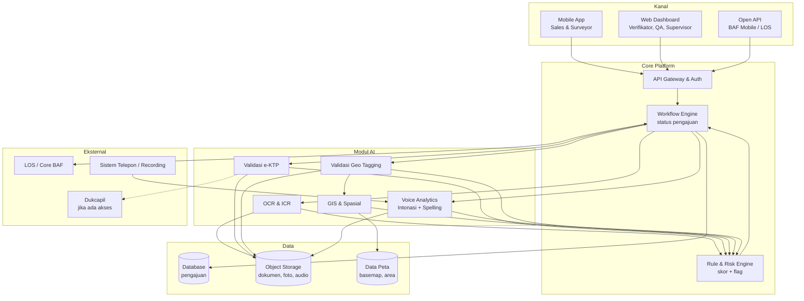
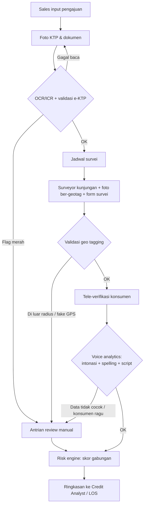
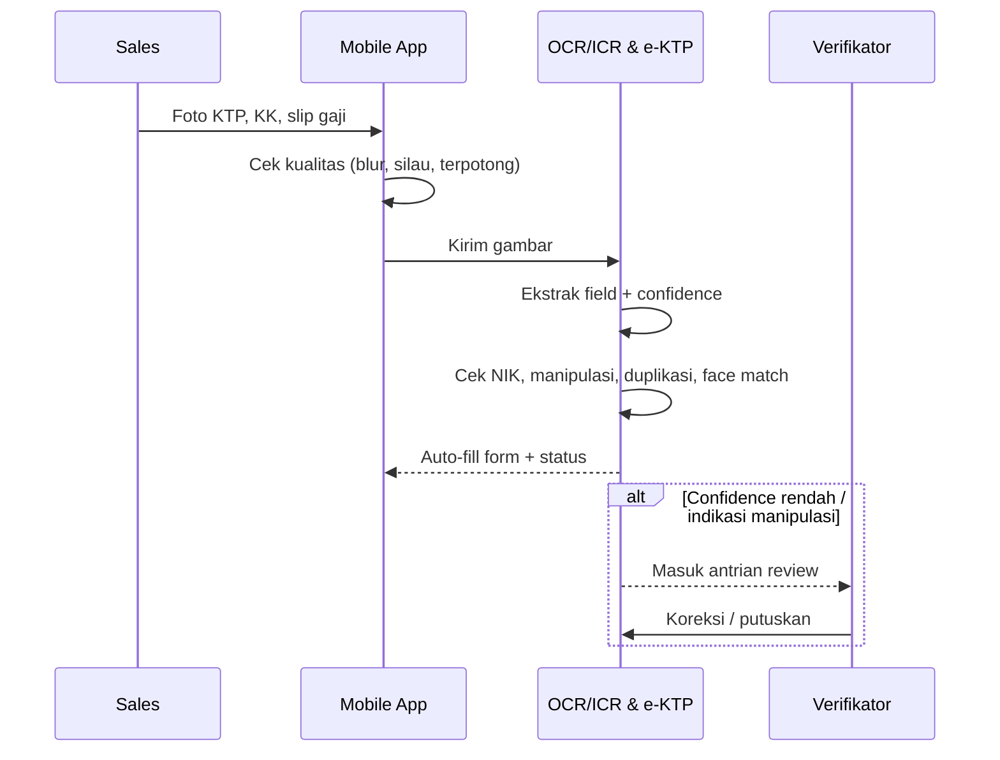
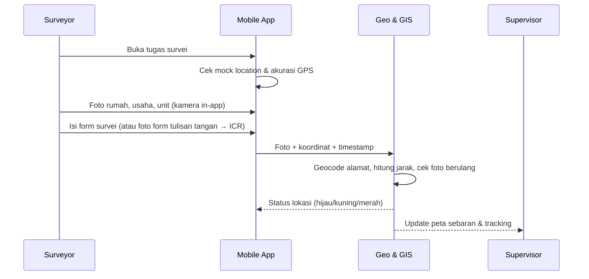
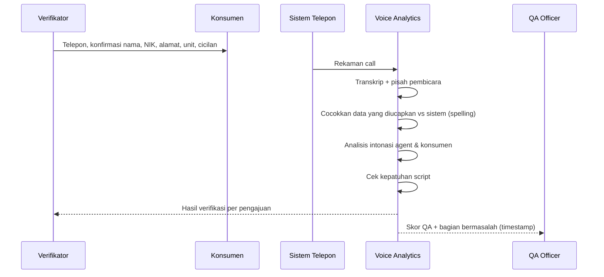
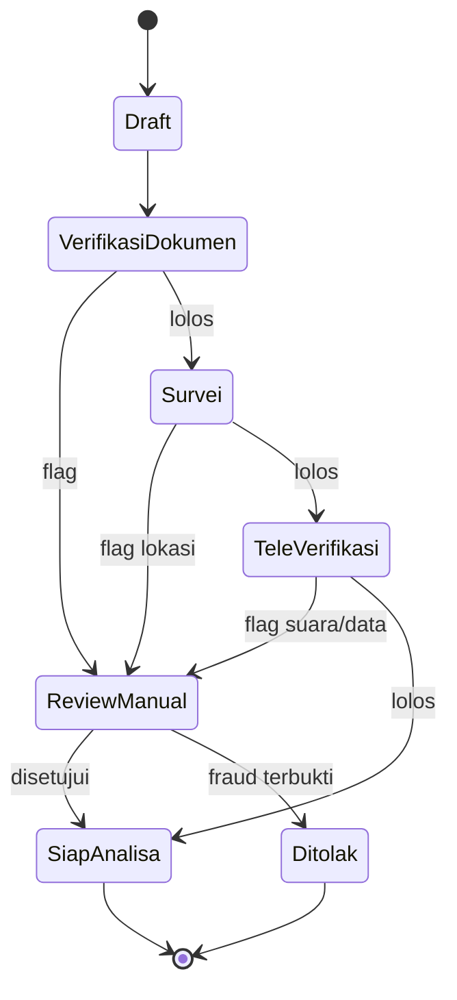

# Perancangan Aplikasi: Platform Verifikasi & QA Pembiayaan BAF

> Nama kerja: **VeriFin** (placeholder, bisa diganti)
> Status: draft v0.1 untuk bahan deck/demo. Poin bertanda **[Asumsi]** perlu dikonfirmasi.
> Scope fase 1: OCR, ICR, validasi e-KTP, validasi geo tagging, GIS, analisis intonasi suara, verifikasi spelling.
> Di luar scope fase 1: credit analyst (ditunda oleh BAF).

---

## 1. Tujuan

Satu platform yang membantu BAF memverifikasi setiap pengajuan pembiayaan secara otomatis:

1. **Data benar**: dokumen dibaca otomatis (OCR/ICR), e-KTP valid.
2. **Lokasi benar**: surveyor benar-benar datang ke alamat konsumen (geo tagging + GIS).
3. **Komunikasi benar**: verifikasi telepon sesuai standar, data diucapkan dan dikonfirmasi dengan benar (intonasi + spelling).

Hasil akhirnya adalah **skor risiko dan flag anomali per pengajuan**, yang dipakai tim verifikasi/analis sebelum keputusan kredit.

---

## 2. Pengguna (Aktor)

| Aktor | Peran | Kanal |
|-------|-------|-------|
| Sales / Marketing Dealer | Input pengajuan, unggah dokumen konsumen | Aplikasi mobile |
| Konsumen | Ajukan sendiri via BAF Mobile (opsional, lewat API) | BAF Mobile |
| Surveyor (CMO/Field) | Kunjungan lapangan, foto lokasi, isi form survei | Aplikasi mobile |
| Verifikator / Tele-verifikasi | Telepon konsumen untuk konfirmasi data | Sistem call center + web |
| QA Officer | Review hasil QA call, tindak lanjut flag | Dashboard web |
| Supervisor / Kepala Cabang | Monitoring survei, kinerja tim, peta sebaran | Dashboard web |
| Credit Analyst | Lihat ringkasan risiko sebelum memutuskan | Dashboard web |
| Admin | Atur user, aturan validasi, threshold | Dashboard web |
| Sistem eksternal | LOS/core BAF, Dukcapil, sistem telepon | API |

---

## 3. Arsitektur Modul

---

## 4. Pemetaan Fitur

### 4.1 Modul OCR & ICR (Dokumen)
| Fitur | Deskripsi | Pengguna |
|-------|-----------|----------|
| Capture dokumen | Kamera dengan panduan bingkai, cek blur/silau/terpotong | Sales, Surveyor |
| OCR dokumen cetak | Ekstrak KTP, KK, NPWP, slip gaji, STNK, BPKB, faktur | Sistem |
| ICR tulisan tangan | Baca form survei manual, catatan, isian tangan | Sistem |
| Auto-fill form | Hasil ekstraksi langsung mengisi form pengajuan | Sales |
| Confidence score | Field dengan keyakinan rendah ditandai untuk dicek manual | Verifikator |
| Cross-check antar dokumen | Nama/NIK/alamat di KTP vs KK vs slip gaji harus konsisten | Sistem |
| Koreksi manual | Verifikator membetulkan hasil baca (jadi data latih) | Verifikator |

### 4.2 Modul Validasi e-KTP
| Fitur | Deskripsi |
|-------|-----------|
| Cek format NIK | Struktur NIK vs kode wilayah, tanggal lahir, jenis kelamin |
| Deteksi manipulasi | Edit digital, foto dari layar, fotokopi, tempelan |
| Face match (opsional) | Selfie vs foto di KTP |
| Liveness (opsional) | Pastikan selfie dari orang asli, bukan foto |
| Cek Dukcapil **[Asumsi]** | Hanya jika BAF sudah punya akses resmi |
| Cek duplikasi internal | NIK/foto sudah pernah dipakai di pengajuan lain |

### 4.3 Modul Validasi Geo Tagging
| Fitur | Deskripsi |
|-------|-----------|
| Foto ber-geotag wajib | Foto hanya bisa diambil dari kamera aplikasi (bukan galeri) |
| Ambil koordinat + waktu | GPS, akurasi, timestamp server |
| Deteksi lokasi palsu | Fake GPS / mock location, akurasi jelek, waktu tidak wajar |
| Jarak ke alamat | Geocoding alamat konsumen, hitung selisih jarak |
| Aturan radius | Contoh: lebih dari 200 m = flag kuning, lebih dari 1 km = flag merah (bisa diatur) |
| Deteksi foto berulang | Foto sama dipakai untuk konsumen berbeda |

### 4.4 Modul GIS
| Fitur | Deskripsi |
|-------|-----------|
| Peta sebaran | Pengajuan, survei, konsumen per cabang |
| Tracking kunjungan | Riwayat titik kunjungan surveyor per hari |
| Heatmap risiko | Area dengan flag fraud/NPL tinggi |
| Geofence cabang | Batas wilayah kerja tiap cabang/surveyor |
| Plot agunan **[Asumsi]** | Plot lokasi agunan properti (versi "Sentuh Tanahku"), fase 2 |
| Filter & export | Per tanggal, cabang, status, tingkat risiko |

### 4.5 Modul Voice Analytics
| Fitur | Deskripsi |
|-------|-----------|
| Ingest rekaman | Ambil rekaman dari sistem telepon / upload |
| Speech-to-text | Transkrip Bahasa Indonesia, pisah pembicara (agent vs konsumen) |
| **Analisis intonasi** | Tone agent (ramah, ketus, tergesa), emosi konsumen (marah, ragu, tertekan) |
| Deteksi keraguan konsumen | Jeda panjang, nada ragu saat ditanya data. Indikasi ketidaksesuaian/fraud |
| **Verifikasi spelling** | Nama, NIK, alamat, nominal yang diucapkan dicocokkan dengan data sistem |
| Kepatuhan script | Salam, identifikasi, pernyataan wajib, penutup sudah diucapkan |
| Skor QA otomatis | Skor per call + bagian yang bermasalah (dengan timestamp) |
| Pemetaan lintas kanal | Dipakai juga untuk collection & customer service (lihat 4.6) |

### 4.6 Pemetaan Intonasi Suara ke Proses Lain
| Proses | Kegunaan intonasi | Output |
|--------|-------------------|--------|
| Tele-verifikasi pengajuan | Deteksi konsumen ragu/dipandu pihak lain | Flag risiko fraud |
| Collection (penagihan) | Deteksi agent kasar/mengancam, emosi konsumen | Kepatuhan etika penagihan (OJK), eskalasi |
| Customer service | Kepuasan, kemarahan pelanggan | Prioritas tindak lanjut komplain |
| Telesales / cross-sell | Minat konsumen, gaya bicara agent | Coaching agent |
| Welcome call | Pemahaman konsumen terhadap kewajiban | Bukti edukasi konsumen |

### 4.7 Rule & Risk Engine
| Fitur | Deskripsi |
|-------|-----------|
| Skor risiko gabungan | Bobot dari tiap modul jadi satu skor (0–100) |
| Flag merah/kuning/hijau | Dengan alasan yang jelas per flag |
| Aturan bisa diatur | Threshold, bobot, radius oleh admin |
| Audit trail | Semua hasil & perubahan tersimpan untuk audit |

### 4.8 Dashboard & Laporan
- Antrian verifikasi (task list per verifikator)
- Detail pengajuan: dokumen, hasil OCR, status e-KTP, peta lokasi, rekaman + transkrip, skor
- Kinerja surveyor & agent (jumlah, flag, skor QA)
- Laporan harian/bulanan, export Excel/PDF

### 4.9 Pemetaan Fitur per Platform

Keterangan: **📱 Mobile** = aplikasi Android (Sales & Surveyor) · **💻 Web** = dashboard browser (tim kantor) · **⚙️ Backend** = proses otomatis di server/API, tanpa layar langsung.

| Modul | Fitur | 📱 Mobile | 💻 Web | ⚙️ Backend |
|-------|-------|:---:|:---:|:---:|
| **OCR & ICR** | Capture dokumen + cek kualitas foto | ✅ | | |
| | OCR dokumen cetak | | | ✅ |
| | ICR tulisan tangan | | | ✅ |
| | Auto-fill form pengajuan | ✅ | | |
| | Tampil confidence score (field kuning) | ✅ | ✅ | |
| | Cross-check antar dokumen | | | ✅ |
| | Koreksi manual hasil baca | ✅ (sales/surveyor) | ✅ (verifikator) | |
| **e-KTP** | Foto KTP + selfie/liveness | ✅ | | |
| | Cek format NIK, manipulasi, duplikasi | | | ✅ |
| | Face match, cek Dukcapil | | | ✅ |
| | Review hasil validasi | | ✅ | |
| **Geo Tagging** | Kamera in-app + ambil GPS & timestamp | ✅ | | |
| | Deteksi fake GPS / mock location | ✅ | | ✅ |
| | Overlay jarak ke alamat konsumen | ✅ | | |
| | Hitung jarak, aturan radius, foto berulang | | | ✅ |
| | Isi alasan bila di luar radius | ✅ | | |
| | Mode offline + sinkron | ✅ | | |
| **GIS** | Peta sebaran pengajuan & survei | | ✅ | |
| | Tracking rute surveyor | | ✅ | |
| | Heatmap risiko, geofence cabang | | ✅ | |
| | Peta tugas survei terdekat (navigasi) | ✅ | | |
| | Geocoding alamat, analisis spasial | | | ✅ |
| **Voice Analytics** | Ingest rekaman dari sistem telepon | | | ✅ |
| | Speech-to-text, pisah pembicara | | | ✅ |
| | Analisis intonasi & keraguan konsumen | | | ✅ |
| | Verifikasi spelling vs data sistem | | | ✅ |
| | Cek kepatuhan script, skor QA | | | ✅ |
| | Player rekaman + transkrip + highlight timestamp | | ✅ | |
| | Catatan coaching agent | | ✅ | |
| **Risk Engine** | Hitung skor gabungan & flag | | | ✅ |
| | Status pengajuan & notifikasi flag | ✅ | ✅ | |
| | Antrian review flag & keputusan | | ✅ | |
| | Ringkasan risiko untuk credit analyst | | ✅ | |
| **Dashboard & Admin** | Daftar tugas harian | ✅ | ✅ | |
| | Laporan & kinerja tim, export | | ✅ | |
| | Atur aturan, threshold, user | | ✅ | |
| | Audit trail | | ✅ (lihat) | ✅ (catat) |
| **Integrasi** | API ke LOS & BAF Mobile | | | ✅ |

**Ringkasnya:**
- **📱 Mobile = pengumpul bukti di lapangan.** Foto dokumen, foto lokasi ber-geotag, form survei, status tugas.
- **💻 Web = tempat memeriksa dan memutuskan.** Review flag, peta GIS, QA suara, laporan, pengaturan.
- **⚙️ Backend = otak AI-nya.** Semua analisis (OCR/ICR, e-KTP, geo, suara, skor) jalan otomatis di server. Fitur suara sepenuhnya web + backend, tidak ada di mobile.

---

## 5. Flow Utama

### 5.1 Flow End-to-End Pengajuan

### 5.2 Flow Dokumen (OCR, ICR, e-KTP)

### 5.3 Flow Survei Lapangan (Geo Tagging & GIS)

### 5.4 Flow Tele-verifikasi & QA Suara

### 5.5 Status Pengajuan

---

## 6. Use Case

### Diagram ringkas
| Kode | Use case | Aktor utama |
|------|----------|-------------|
| UC-01 | Input pengajuan & scan dokumen | Sales |
| UC-02 | Validasi e-KTP | Sistem, Verifikator |
| UC-03 | Baca form tulisan tangan (ICR) | Surveyor, Sistem |
| UC-04 | Kunjungan survei ber-geotag | Surveyor |
| UC-05 | Monitoring survei di peta | Supervisor |
| UC-06 | Tele-verifikasi dengan analisis suara | Verifikator, Sistem |
| UC-07 | Review QA call | QA Officer |
| UC-08 | QA call collection | QA Officer, Supervisor Collection |
| UC-09 | Review flag & keputusan manual | Verifikator |
| UC-10 | Lihat ringkasan risiko | Credit Analyst |
| UC-11 | Atur aturan & threshold | Admin |

### UC-01 Input pengajuan & scan dokumen
- **Aktor:** Sales
- **Prasyarat:** Sales login, konsumen hadir/dokumen tersedia
- **Alur utama:**
  1. Sales buat pengajuan baru dan pilih produk (motor/mobil/elektronik/dana).
  2. Foto KTP, KK, dokumen pendukung lewat kamera in-app.
  3. Sistem cek kualitas foto, jalankan OCR, isi form otomatis.
  4. Sales cek dan konfirmasi data, lalu kirim.
- **Alternatif:** foto buram, minta foto ulang. Field confidence rendah ditandai kuning untuk dicek.
- **Hasil:** pengajuan masuk tahap verifikasi dokumen dengan data terstruktur.

### UC-02 Validasi e-KTP
- **Aktor:** Sistem, Verifikator
- **Alur utama:**
  1. Sistem cek struktur NIK vs data (tanggal lahir, wilayah).
  2. Deteksi manipulasi gambar dan cek duplikasi NIK/foto internal.
  3. (Opsional) face match selfie dan cek Dukcapil.
  4. Hasil: valid / perlu review / tidak valid, beserta alasan.
- **Alternatif:** indikasi manipulasi, masuk UC-09.

### UC-03 Baca form tulisan tangan (ICR)
- **Aktor:** Surveyor
- **Alur utama:** surveyor memotret form survei yang diisi manual. ICR membaca field, menampilkan hasil + confidence, surveyor membetulkan field yang salah.
- **Nilai:** surveyor yang terbiasa form kertas tetap bisa, tanpa input ulang di kantor.

### UC-04 Kunjungan survei ber-geotag
- **Aktor:** Surveyor
- **Prasyarat:** tugas survei sudah ditugaskan
- **Alur utama:**
  1. Surveyor buka tugas, aplikasi cek GPS aktif dan bukan mock location.
  2. Ambil foto wajib (depan rumah, usaha, lingkungan) lewat kamera in-app.
  3. Sistem hitung jarak ke alamat konsumen dan tampilkan status.
  4. Surveyor kirim hasil survei.
- **Alternatif:** di luar radius, surveyor wajib isi alasan (misalnya alamat KTP beda dengan domisili), lalu flag kuning.
- **Hasil:** bukti kunjungan valid dan tercatat di peta.

### UC-05 Monitoring survei di peta
- **Aktor:** Supervisor / Kepala Cabang
- **Alur utama:** buka dashboard GIS, filter cabang dan tanggal, lihat titik kunjungan, rute surveyor, dan titik ber-flag. Klik titik untuk detail pengajuan.
- **Nilai:** deteksi surveyor "survei dari rumah" dan area rawan.

### UC-06 Tele-verifikasi dengan analisis suara
- **Aktor:** Verifikator, Sistem
- **Alur utama:**
  1. Verifikator telepon konsumen sesuai script.
  2. Rekaman otomatis masuk ke voice analytics.
  3. Sistem mencocokkan data yang disebut konsumen (nama, alamat, tanggal lahir, unit, cicilan) dengan data pengajuan.
  4. Sistem menganalisis intonasi konsumen (ragu, dipandu) dan agent (sesuai standar).
  5. Hasil tampil di detail pengajuan.
- **Alternatif:** data tidak cocok atau konsumen terdeteksi ragu/dipandu orang lain, maka flag merah dan masuk UC-09.

### UC-07 Review QA call
- **Aktor:** QA Officer
- **Alur utama:** lihat daftar call dengan skor terendah, putar rekaman langsung di bagian bermasalah (timestamp), beri catatan coaching ke agent.
- **Nilai:** QA tidak perlu mendengar semua call; fokus ke yang ber-flag.

### UC-08 QA call collection
- **Aktor:** QA Officer, Supervisor Collection
- **Alur utama:** rekaman penagihan dianalisis untuk nada kasar/ancaman dan kepatuhan etika penagihan, lalu dibuat laporan per agent/vendor collection.

### UC-09 Review flag & keputusan manual
- **Aktor:** Verifikator
- **Alur utama:** buka antrian flag, lihat bukti dari semua modul dalam satu layar, putuskan lanjut / minta data ulang / tolak (indikasi fraud), lalu tulis catatan.

### UC-10 Lihat ringkasan risiko
- **Aktor:** Credit Analyst
- **Alur utama:** buka pengajuan, lihat skor gabungan dan daftar flag beserta alasannya, lalu lanjut proses di LOS.
- **Catatan:** jembatan ke modul credit analyst di fase berikutnya.

### UC-11 Atur aturan & threshold
- **Aktor:** Admin
- **Alur utama:** atur radius geo tagging, bobot skor, threshold confidence OCR, item script wajib, dan kata/nada yang dilarang.

---

## 7. Layar Utama (untuk mockup demo)

**Mobile (Sales & Surveyor)**
1. Login
2. Daftar tugas (pengajuan / survei)
3. Scan dokumen dengan panduan bingkai
4. Hasil OCR, auto-fill dengan field kuning untuk confidence rendah
5. Kamera survei dengan overlay koordinat + jarak ke alamat
6. Ringkasan survei & kirim

**Web Dashboard**
1. Beranda: ringkasan hari ini (pengajuan, flag, skor rata-rata)
2. Antrian verifikasi & flag
3. Detail pengajuan: tab Dokumen, e-KTP, Lokasi (peta), Suara (player + transkrip + highlight), Skor
4. Peta GIS: sebaran, tracking, heatmap
5. QA Call: daftar call, skor, player dengan timestamp masalah
6. Laporan & kinerja tim
7. Pengaturan aturan

---

## 8. Data Utama (Entitas)

| Entitas | Field kunci |
|---------|-------------|
| Pengajuan | id, produk, cabang, sales, status, skor_risiko |
| Konsumen | nik, nama, tgl_lahir, alamat_ktp, alamat_domisili, koordinat_alamat |
| Dokumen | jenis, file, hasil_ekstraksi (JSON), confidence, status_validasi |
| Survei | surveyor, waktu, koordinat, akurasi, jarak_ke_alamat, foto[], hasil_form |
| Rekaman | sumber, durasi, transkrip, skor_intonasi, hasil_spelling, skor_qa |
| Flag | modul, tingkat (merah/kuning), alasan, bukti, status_review |
| Aturan | parameter, nilai, berlaku_sejak, diubah_oleh |
| Audit log | user, aksi, waktu, sebelum/sesudah |

---

## 9. Integrasi

| Sistem | Arah | Keterangan |
|--------|------|-----------|
| LOS / core BAF | Dua arah | Tarik data pengajuan, kirim hasil verifikasi & skor |
| BAF Mobile | Masuk | Pengajuan mandiri konsumen via API |
| Sistem telepon / recording | Masuk | Rekaman call otomatis (batch atau real-time) |
| Dukcapil **[Asumsi]** | Keluar | Hanya jika ada perjanjian akses |
| Basemap & geocoding | Keluar | Peta dan konversi alamat ke koordinat |
| Data pertanahan (BPN) **[Asumsi]** | Keluar | Tidak ada API publik yang terlihat; fase 2, perlu kerja sama resmi |

---

## 10. Kebutuhan Non-Fungsional

- **Keamanan data:** enkripsi saat kirim dan simpan, akses berbasis peran, masking NIK di tampilan. Sesuai UU PDP dan ketentuan OJK.
- **Deployment:** opsi cloud lokal (data di Indonesia) atau on-premise.
- **Kinerja:** OCR kurang dari 5 detik per dokumen; analisis call kurang dari 1x durasi rekaman (target, perlu disesuaikan).
- **Offline mode (mobile):** survei tetap bisa di area sinyal lemah, sinkron saat online (koordinat & timestamp tetap dari perangkat + validasi server).
- **Audit trail:** semua keputusan dan perubahan tercatat.
- **Bahasa:** model suara dan ICR mendukung Bahasa Indonesia dan logat daerah.

---

## 11. Fase Pengembangan

| Fase | Isi | Tujuan |
|------|-----|--------|
| **Demo / PoC** | Alur UC-01, 04, 05, 06, 07 dengan data dummy | Presentasi ke BAF minggu ini |
| **Fase 1 (MVP)** | OCR, e-KTP, geo tagging, GIS dasar, voice analytics tele-verifikasi | Pilot di 1–2 cabang |
| **Fase 2** | ICR form survei, QA collection & CS, heatmap risiko, integrasi LOS penuh | Rollout bertahap |
| **Fase 3** | Credit analyst (scoring), plot agunan properti ("Sentuh Tanahku"), integrasi data eksternal | Ekspansi |

---

## 12. Skenario Demo (rekomendasi, 10–15 menit)

1. **Sales** foto KTP, form terisi otomatis. Tunjukkan satu KTP hasil edit yang ter-flag.
2. **Surveyor** foto lokasi. Tunjukkan satu kasus di luar radius 1,2 km dan ter-flag merah.
3. **Supervisor** buka peta: titik hijau/kuning/merah dan rute surveyor.
4. **Tele-verifikasi:** putar rekaman konsumen salah menyebut tanggal lahir dan terdengar ragu. Sistem menandai keduanya dengan timestamp.
5. **QA:** skor agent dan bagian script yang terlewat.
6. **Ringkasan risiko:** satu layar dengan skor gabungan dan alasan flag.

---

## 13. Yang Perlu Dikonfirmasi

1. Arti persis "ICR kayak Sentuh Tanahku": baca sertipikat, atau plot lokasi agunan?
2. BAF punya produk dengan agunan properti?
3. Akses Dukcapil sudah ada?
4. Sistem telepon dan format rekaman yang dipakai BAF?
5. LOS yang dipakai dan kesiapan API-nya?
6. Prioritas proses untuk intonasi suara: tele-verifikasi, collection, atau CS dulu?
7. Preferensi deployment: cloud atau on-premise?
